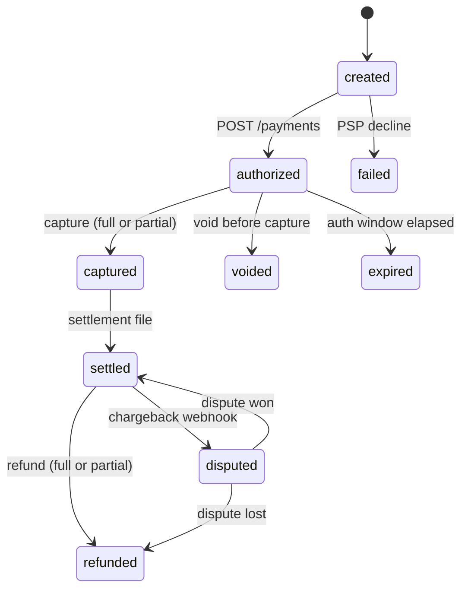

# Money Movement Review

How I pressure-test a money-movement path — a PSP integration, payout
pipeline, refund flow, or internal transfer. Output: a findings list ranked
by severity with evidence, plus the state diagram if one doesn't exist yet.

The procedure below is the payment-flow pass. Two rule sets travel with it:

- [MONEY.md](MONEY.md) — how amounts are represented and computed: minor
  units, currency, rounding, allocation, FX. Read it when the review touches
  amounts, prices, fees, or conversion, or when designing new money-handling code.
- [LEDGER.md](LEDGER.md) — how movements are recorded: double-entry,
  immutability, derived balances, reconciliation, trial balance. Read it when the
  review reaches a ledger, balance, wallet, payout, or statement.

A payment review that skips the two rule sets is incomplete; a pricing column or
ledger schema can be reviewed against a rule set alone.

## Procedure

### 1. Draw the state machine (even if the code doesn't have one)
- States: created → authorized → captured (full/partial) → settled; branches
  for voided, refunded (full/partial), disputed/chargeback, failed, expired.
- For every transition: what triggers it (API call, webhook, cron), what
  records it, and whether the trigger can fire more than once.
- Illegal transitions must be impossible in code, not merely absent from the
  happy path. Refund after void? Capture after expiry? Second capture?
- If payment state is a single mutable status string with no transition
  guard, that is finding #1.

Draw it as a Mermaid `stateDiagram-v2`, labelling every transition with its
trigger. It renders on the tracker, it diffs, and an illegal transition is
visible by its absence — which is the point of drawing it at all.

Roughly fifteen states is the ceiling; past that Mermaid's layout stops
helping and the machine wants splitting per flow. Nothing in a terminal
renders Mermaid, so an agent cannot see its own syntax errors: stay on
`stateDiagram-v2`, `flowchart` and `sequenceDiagram`, and confirm the
diagram rendered before relying on it.

### 2. Idempotency
- Every mutating PSP call carries an idempotency key derived from the
  business operation — not a fresh UUID per attempt, which defeats the point.
- Every inbound effect (webhook, callback, job) is processed idempotently:
  unique constraint or dedupe table keyed on the provider's event id.
- The question "this timed out — did it happen?" must have a safe answer
  (query the PSP, then reconcile). Never "resubmit and hope."

### 3. Webhooks
- Signature verified before parsing. Reject on failure — don't log-and-continue.
- Assume duplicates and out-of-order delivery. Transitions guard on current
  state, or events are applied through ordered/versioned processing.
- Handlers do minimal work: verify, persist, ack, process async. Slow
  handlers cause PSP retries, which cause duplicates.
- There is a backfill/poll path for missed webhooks, because some will be missed.

### 4. Failure modes — walk each one explicitly
- Timeout-then-success: the request timed out client-side but succeeded at the PSP.
- Double-submit: the user clicked twice.
- Partial capture / partial refund arithmetic (see allocation in [MONEY.md](MONEY.md)).
- Stuck pending: what watches for payments that never resolve, and what's the SLA?
- PSP outage: queue, fail, or degrade — a deliberate choice, not an accident.

### 5. Reconciliation hooks
- Every state change writes a record matchable to the PSP's reports: their
  id, amount, currency, timestamp.
- Fees are recorded per transaction, not discovered monthly in the invoice.
- The ledger side lives in [LEDGER.md](LEDGER.md); this review just
  confirms the raw material exists.

### 6. User-visible consistency
- Map each internal state to what the user sees. No screen shows "paid" from
  an optimistic write that a webhook can later contradict.
- Pending states are honest ("processing") with a defined resolution time.

## Red flags — instant findings
- Status driven by the API response alone with webhooks ignored, or the
  reverse, with no reconciliation between the two sources.
- Refund logic that recomputes amounts instead of referencing the original charge.
- Amounts crossing the PSP boundary as floats (→ [MONEY.md](MONEY.md)).
- Webhook signing secrets hardcoded (stop and flag per global safety rules).
- No local/test story for webhooks. Untested webhook handling is broken
  webhook handling.

## Test checklist
- Replay the same webhook five times: exactly one state change.
- Deliver capture-then-auth out of order: correct final state.
- Kill the process mid-transition, restart: no orphaned state.
- Refund attempted after a dispute opens: blocked or handled per PSP rules.
- Retry storm on a mutating endpoint with one idempotency key: one effect.

## Related
- [threat-model](../threat-model/) (payment flows are always security-sensitive) · [pci-dss-scoping](../pci-dss-scoping/) · [kyc-aml-review](../kyc-aml-review/)
